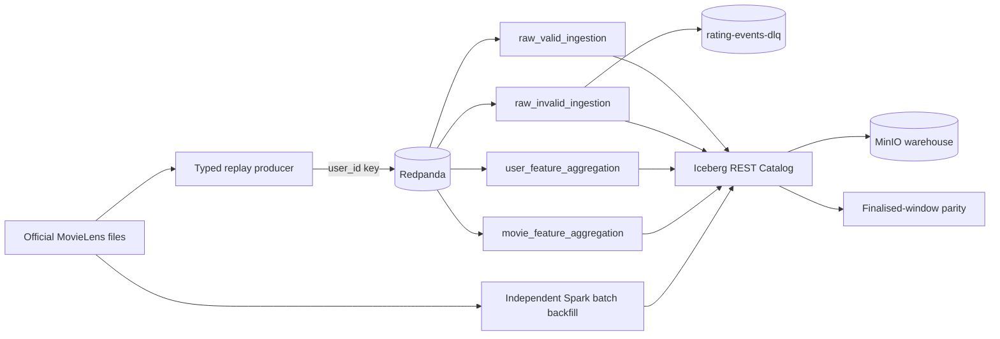

# Stream-Batch Recommendation Feature Platform

An independent local data-engineering project using containerised services.

This project turns official GroupLens MovieLens ratings into versioned,
event-time recommendation features through both streaming and independent
batch paths. Its purpose is correctness and failure evidence: validation,
watermarks, deduplication, idempotent Iceberg writes, restart recovery, and
batch-stream parity. It does not train or serve a recommendation model.

## Architecture



| Component | Responsibility |
|---|---|
| Redpanda | Single-broker Kafka-compatible event log and three-partition topics |
| Producer | Canonical schema-v1 events, deterministic faults, checked acknowledgements |
| Spark | Four named Structured Streaming queries plus batch/parity jobs |
| Iceberg REST | Catalog API over a persistent local SQLite `JdbcCatalog` |
| MinIO | S3-compatible Iceberg warehouse |
| Console | Local topic inspection only |

The stack is pinned to Spark/PySpark 3.5.8, Scala 2.12, Java 17, Iceberg
1.10.1, Redpanda 26.1.13, Console 3.8.0, and a reproducibly source-built MinIO
`RELEASE.2025-10-15T17-29-55Z`. Registry images and base images use immutable
digests in [docker-compose.yml](docker-compose.yml) and the Dockerfiles.

## Event contract and partitioning

Schema v1 contains `event_id`, `schema_version`, `user_id`, `movie_id`,
`rating`, `event_time`, `ingestion_time`, `source`, and `replay_run_id`.
Identifiers are positive signed 64-bit integers; ratings are 0.5–5.0 in
half-star steps; both timestamps must parse as UTC; version must equal 1; and
source/replay ID must be non-empty.

`event_id` is SHA-256 over source, version, user, movie, one-decimal rating,
and original UTC event time, separated canonically. It deliberately excludes
replay and ingestion fields, so retries and replay runs retain identity.

`rating-events` is keyed by the UTF-8 representation of `user_id`. This gives
ordering only within that user's assigned partition. It does not give global,
per-movie, or event-time ordering. Both topics have three partitions,
replication factor one, delete cleanup, and seven-day retention. The single
broker does not demonstrate high availability.

## Streaming design

Four independent named queries each reread the Kafka topic and own a durable
checkpoint:

| Query | Checkpoint | Sink |
|---|---|---|
| `raw_valid_ingestion` | `/checkpoints/raw_valid` | `raw.valid_rating_events` |
| `raw_invalid_ingestion` | `/checkpoints/raw_invalid` | invalid table and DLQ |
| `user_feature_aggregation` | `/checkpoints/user_features` | user stream features |
| `movie_feature_aggregation` | `/checkpoints/movie_features` | movie stream features |

The repeated Kafka parsing is an intentional cost of isolated query
checkpoints and failure domains. Each `foreachBatch` invocation performs a
deterministic `MERGE INTO`; only successful catalog operations are reported as
successful. The SQLite development catalog has one writer, so driver-side
catalog commits are serialized and its JDBC URL uses a 30-second busy timeout.

Malformed/invalid events retain the exact binary payload, every validation
error, topic, partition, offset, key, Kafka timestamp, and ingestion timestamp.
Their logical ID is SHA-256 of topic, partition, and offset. The Iceberg merge
is idempotent. The DLQ is at-least-once: a retry after an Iceberg commit can
duplicate a Kafka DLQ message, so consumers must deduplicate by invalid ID.

## Feature and event-time semantics

Feature definition v1 computes count, average, minimum, and maximum rating for
each user and movie over seven-day UTC windows sliding daily. The streaming
path applies a 24-hour event-time watermark and
`dropDuplicatesWithinWatermark(["event_id"])`, then emits finalised append-mode
windows. Duplicate state is bounded, not universal: a duplicate arriving
beyond retained watermark state can be processed again. Events later than the
watermark are discarded from feature state but remain in the valid raw table.

The batch path independently reads the downloaded MovieLens file, validates
it, builds the same Spark expressions, and merges logical feature keys. It does
not depend on the producer or raw streaming table. Reruns update the same keys
instead of adding logical duplicates.

Parity considers only batch windows whose end is no later than the maximum
finalised streaming window. Counts/min/max compare exactly; averages use
absolute tolerance `1e-9`. Missing, unexpected, exact-value, and floating-point
mismatches are reported and persisted—success is never hard-coded.

## Iceberg layout

All tables use format v2, Zstandard Parquet, and deterministic merges. Iceberg
does not enforce relational primary keys.

| Table group | Tables | Logical key | Partition |
|---|---|---|---|
| Valid raw | `raw.valid_rating_events` | `event_id` | month(event time) |
| Invalid raw | `raw.invalid_rating_events` | invalid record ID | day(ingestion) |
| Stream features | user, movie | entity/window/version | month(window start) |
| Batch features | user, movie | entity/window/version | month(window start) |
| Audit | pipeline runs, parity results | run/result ID | day(created) |

No transaction spans Kafka, multiple Iceberg tables, or DLQ output. The
project therefore makes no general end-to-end exactly-once claim.

## Quick start

Prerequisites: Docker Desktop with Linux containers and at least the verified
8 CPU / 16 GB Docker allocation, plus Python 3.11.

Windows:

```powershell
py -3.11 scripts/task.py setup
py -3.11 scripts/task.py up
py -3.11 scripts/task.py download-data --profile ml-100k
py -3.11 scripts/task.py create-topics
py -3.11 scripts/task.py init-tables
py -3.11 scripts/task.py run-stream
py -3.11 scripts/task.py produce-dev --profile ml-100k --max-records 100000
py -3.11 scripts/wait_for_stream.py
docker compose --profile jobs stop -t 60 streaming-job
py -3.11 scripts/task.py run-batch --profile ml-100k
py -3.11 scripts/task.py parity
```

Linux uses the same commands with `python3` instead of `py -3.11`. GNU Make is
optional; [scripts/task.py](scripts/task.py) is the source of truth and
[scripts/task.ps1](scripts/task.ps1) is a PowerShell convenience wrapper.

Required task commands are `setup`, `up`, `download-data`, `create-topics`,
`init-tables`, `test`, `integration-test`, `run-stream`, `produce-dev`,
`run-batch`, `parity`, `recovery-test`, `benchmark`, `report`, `down`, and
`clean`.

Persistent cleanup is deliberately guarded:

```powershell
py -3.11 scripts/task.py clean --volumes --confirm DELETE_PERSISTENT_DATA
```

## Testing, recovery, and benchmark

```powershell
py -3.11 scripts/task.py test
py -3.11 scripts/task.py spark-test
py -3.11 scripts/task.py integration-test
py -3.11 scripts/task.py recovery-test
py -3.11 scripts/task.py benchmark
py -3.11 scripts/task.py report
```

The recovery scenario observes committed offsets, records checkpoint files,
SIGKILLs the entire stream container, restarts the same service with preserved
checkpoints, verifies new query run IDs and logical uniqueness, and separately
restarts MinIO/catalog against their named volumes. This proves one
streaming-process restart—not broker failure, cluster failover, or HA.

The benchmark uses every MovieLens 1M row. It increases conservative candidate
producer rates, accepts only controlled backlog/catch-up, derives low and
medium rates as fractions of the observed ceiling, and runs three trials per
rate before completing the remaining dataset with deterministic duplicates and
out-of-order delivery.

<!-- VERIFIED_RESULTS_START -->
### Recorded local benchmark (27 July 2026)

| Evidence | Measured result |
|---|---:|
| MovieLens 1M source rows | 1,000,209 |
| Highest sustainable producer target | 3,000 events/s |
| High-rate producer actual p50, 3 trials | 2,999.9 events/s |
| High-rate Spark processed-rate p50 | 2,094.4 rows/s |
| High-rate micro-batch duration p50 / p95 | 3,271 / 7,387 ms |
| Injected duplicate messages / deduplicated valid rows | 17,604 / 1,000,209 |
| Reordered events | 44,010 |
| User / movie finalised-window parity | 100.0% / 100.0% |
| Streaming-process restart recovery | 12.641 s |
| Invalid records / DLQ messages in contract test | 2 / 2 |

All values above are rendered from `reports/evidence/*.json`. They are dated local Docker measurements, not production capacity claims. The finalised parity comparison contains 105,318 user rows and 931,842 movie rows: 1,037,160 feature rows in total.
<!-- VERIFIED_RESULTS_END -->

See [testing](docs/testing.md) for test boundaries and evidence commands.

### Publication audit (8 October 2026)

The existing checkout passed Ruff, mypy (12 source files), a Docker Compose
build/start with six healthy services, and all 47 tests: 38 unit, three Spark,
two live Docker integration, and four checks of recorded evidence. The four
evidence checks validate saved JSON; they do not rerun the benchmark, SIGKILL,
DLQ, or storage-restart scenarios.

A fresh parity job against the retained Iceberg tables matched all 126,458
user and 1,095,665 movie feature rows (1,222,123 total), with no missing,
unexpected, or value-mismatched rows. This later watermark includes more
finalised windows than the recorded July benchmark. The live table probe found
1,000,211 unique valid records, including the benchmark's watermark/contract
events; it does not represent a fresh 1M replay.

The unit suite reproduced 88.69% combined statement/branch coverage with
branch measurement enabled; branch-only coverage was 82/100 branches (82%).
The configured denominator excludes the streaming, batch, Iceberg, parity,
and platform-probe modules. The 1M producer-rate benchmark and 12.641-second
SIGKILL measurement were not rerun for publication. Use the commands above
to reproduce them on a suitable local Docker environment; timings will vary.

## Failure modes and scaling considerations

- Named checkpoints recover query offsets/state, but loss of the checkpoint
  volume can replay from Kafka and relies on deterministic Iceberg keys.
- SQLite serializes catalog writes and is an explicit local-development
  bottleneck. A production catalog would need a durable concurrent database.
- One Redpanda broker means a broker/container loss interrupts the platform.
- MinIO is one local container/volume and is not a durability proof.
- A hot user concentrates a Kafka partition and state-store key; hot movies
  can create aggregation skew even though the producer partitions by user.
- Scaling requires more brokers/replication, production object storage and
  catalog, more Spark executors, partition/skew analysis, compaction and file
  maintenance, plus operational monitoring.

RocksDB state store, eight shuffle partitions, ten-second triggers, two cores
per stream application, and resource limits are explicit local tuning choices.
Benchmark evidence records these settings and observed pressure rather than
presenting them as universal defaults.

## Security and dataset provenance

Credentials in `.env.example` are local-only defaults, ports bind to localhost,
and the platform has no authentication, TLS, authorization, encryption,
multi-tenancy, or secret manager. Do not expose it to an untrusted network.

MovieLens 100K and 1M are downloaded only from GroupLens. Archives are checked
against MD5 `0e33842e24a9c977be4e0107933c0723` and
`c4d9eecfca2ab87c1945afe126590906`; raw records, archives, expanded datasets,
and local provenance/licence copies are ignored by Git. Review the downloaded
GroupLens README/licence before redistribution. The code is Apache-2.0.

## What this project does not prove

The local environment does not prove:

- TikTok or billion-user scale;
- multi-region operation;
- production Kafka operations;
- production object-storage durability;
- full end-to-end exactly-once delivery;
- high availability;
- real recommendation workload performance.

It is not cloud deployed, production operated, or validated with real users.
It omits a recommendation model, UI, Kubernetes, Terraform, authentication,
Grafana, and cloud deployment by design.

