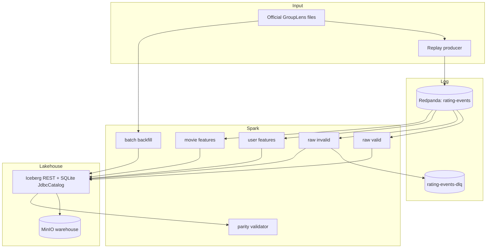

# Architecture

The platform separates event capture, stream computation, independent batch
recomputation, storage, and correctness comparison.

## Why four stream queries

Each named query owns a durable checkpoint and can retry independently. Spark
does not reuse one materialized parsed stream across those query lifecycles;
the Kafka topic is therefore read and parsed four times. This costs broker and
CPU work but makes the topology and checkpoint contracts explicit.

The checkpoints are `/checkpoints/raw_valid`, `/checkpoints/raw_invalid`,
`/checkpoints/user_features`, and `/checkpoints/movie_features`. Kafka
consumer-group prefixes are unique, but correctness depends on Spark
checkpoints/source offsets rather than Kafka committed consumer offsets.

## Local catalog design

The pinned Iceberg REST fixture loads `org.sqlite.JDBC` and exposes a
`JdbcCatalog` whose database is on the `iceberg_catalog` named volume. MinIO
objects use the separate `minio_data` volume. The compatibility probe creates
all namespaces/tables, performs repeated table-property commits, restarts the
catalog, and rereads the property/table.

SQLite permits one writer. Concurrent query commits reproduced `SQLITE_BUSY`
and an Iceberg unknown commit state. The implemented development fix serializes
driver catalog commits and sets `busy_timeout=30000` on the fixture JDBC URL.
This preserves the locked SQLite architecture while making contention wait
observable. It is not a recommendation for a production catalog.

## Resource model

Compose limits Redpanda, MinIO, catalog, Spark master/worker, and stream driver.
The worker advertises four cores and 6 GB; a streaming application uses two
cores so a batch/probe application can run only when capacity permits. The
benchmark evidence records actual Docker-visible resources and limits.

External ports bind to `127.0.0.1`. The `platform` bridge network carries
service traffic. Init containers set named-volume ownership and create a
private `warehouse` bucket only after health checks pass.

## Scaling path

A production-oriented evolution would require a replicated Kafka cluster,
durable object storage, a concurrent durable catalog database/service,
multiple Spark executors, catalog/file maintenance, telemetry, TLS and access
control. User-key partitioning preserves per-user partition order but can skew
on hot users; movie aggregation can skew on globally popular movies. Both need
measurement before repartitioning or salting.

